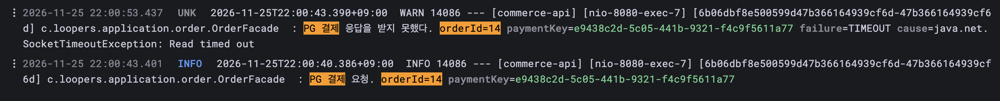
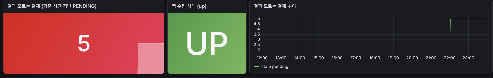
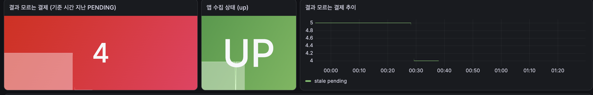

# 결제 응답 유실 사고 실험 일지

[기획](checkout-incident-plan.md)의 단계를 진행하며 한 일, 알게 된 것, 실행 기록을 시간 순서로 남긴다.

## 진행 표

| 날짜 | 단계 | 한 일 | 결과 |
| ---- | ---- | ----- | ---- |
| 2026-11-22 | 1 | `LocalPgFixture`·`LocalPgFixtureTest`·`CheckoutIncidentTest`(baseline) 추가. 프로덕션 코드 변경 없음 | fixture 5개, baseline 1개 통과. ktlint·ArchUnit 통과 |
| 2026-11-23 | 2 | PG 경계 로그 3줄, gauge `payment.pending.stale`, `transactionKey` 전달, 관측 테스트 `observesLostResponse` 추가 | incident 7개 통과. commerce-api 전체 479개 중 8개 실패 — 모두 Outbox·이벤트 테스트이고 변경 전 커밋 d8c12ca 에서도 같은 8개가 실패함. ktlint·ArchUnit 통과 |
| 2026-11-25 | 3 | `keepsIncidentState` 추가(baseline → fault 를 한 테스트에서). baseline 단언은 `runBaseline` 으로 옮겨 두 테스트가 같이 씀. 프로덕션 코드 변경 없음 | incident 8개 통과. 응답 유실 주입을 빼면 실패하는 것 확인. ktlint 통과 |
| 2026-11-26 | 5 준비 | 본인 주문 대사 API `POST /api/v1/orders/{orderId}/reconcile` 추가. 로컬 14번 대사 | 대사 테스트 10개 통과. commerce-api 전체 490개 중 8개 실패(기존 Outbox 8개 동일). 14번 SUCCESS, 새 결제 없음 |

## 1번에서 알게 된 것

- 2번 로그 작업 때 주의: PG timeout 은 예외 이름이 아니라 원인이 `SocketTimeoutException` 인지로 판단한다. 실제로는 `ResourceAccessException` 이 아니라 `RestClientException` 으로 와서, 이름으로 가르면 timeout 을 다른 실패로 잘못 기록한다.
- baseline 실측: Payment `SUCCESS` 10, PG 거래 10(모두 `SUCCESS`, 금액 39,000), create 10(중복 0), 재고 예약 `COMMITTED` 10, 상품 재고 30 → 20, 포인트 50,000 그대로, management 포트의 health `UP`.
- 테스트 설정: `pg.read-timeout=500ms`, fixture 의 응답 유실 대기 1.5s, `management.server.port=0`(랜덤).

## 2번에서 알게 된 것

- Spring Boot 테스트는 지표 내보내기를 기본으로 끈다. `/actuator/prometheus` 가 없어서 gauge 가 안 보였다. 관측 테스트에만 `@AutoConfigureObservability(tracing = false)` 를 붙였다.
- 실제 로그: `PG 결제 응답을 받지 못했다. orderId=1 paymentKey=… failure=TIMEOUT cause=java.net.SocketTimeoutException: Read timed out`
- gauge 관찰 범위: 생성 후 `payment.metrics.stale-pending-after`(기본 1m, 테스트 2s)가 지난 PENDING. 갱신 주기: Prometheus 가 수집할 때마다 DB 를 센다(로컬 Prometheus 는 5초 간격). 그래서 실제 값은 기준 시간 + 수집 간격만큼 늦게 오를 수 있다.
- 테스트 사이 주문 ID 가 다시 1 부터 시작해서(TRUNCATE) fixture 거래가 섞일 수 있다. `LocalPgFixture.reset()` 을 추가해 테스트마다 비운다.
- settle 반영 로그는 과제 원문에 없어 넣지 않았다.

### 2번 시작 전 로컬 모니터링 상태 (2026-11-23 확인)

- Prometheus `localhost:9090` 정상, `host.docker.internal:8081/actuator/prometheus` 를 5초마다 수집, target `up`.
- Grafana `localhost:3000` 정상(13.2.1), 데이터소스 Prometheus 연결됨.
- 결제 관련 지표 0개.
- 8080/8081 에 떠 있는 commerce-api 는 11-13 다른 세션이 띄운 예전 jar 다. 2단계 코드를 Grafana 로 보려면 이걸 내리고 이번 코드로 다시 띄워야 한다.

## 3번에서 알게 된 것

- 장애 3건은 응답 유실과 콜백 보류를 **함께** 건다. 과제 원문: "고정한 3개만 거래 SUCCESS 저장 뒤 생성 응답 유실 / 해당 3개의 callback 전달과 자동 reconcile은 관찰 시점까지 보류". 콜백 보류는 별도 원인이 아니라 콜백이 와서 저절로 고쳐지지 않게 막는 장치다.
- 장애 3건은 실제 생성한 주문 ID 목록의 고정 위치(2·5·8번째)로 고른다. 실행 순서의 우연에 기대지 않는다.
- fault 실측: 확정 응답 500 3건·200 7건, Payment `SUCCESS` 7 / `PENDING` 3(정확히 고른 3건), PG 거래 누적 20(장애 집합 10건 모두 `SUCCESS`), create 누적 20(중복 0), 장애 3건 재고 예약 `RESERVED` 유지·7건 `COMMITTED`, 재고 30 → 10, 포인트 그대로, gauge 3, health `UP`, 장애 3건 모두 `failure=TIMEOUT` 로그.
- `finally` 에서 주입만 끄고(`clearFaults`) 거래·DB 는 지우지 않는다. 테스트가 끝난 뒤 `@AfterEach` 가 비우는 건 다음 테스트를 위한 정리다. 실행 증거를 파일로 남기는 건 7단계에서 한다.
- 로컬 앱 재현(2026-11-25): pg-simulator 에 테스트 카드 `3333`(접수 응답 10초 지연 + 콜백 안 보냄, 0.6.0)을 추가하고 콜백 주소를 8080 으로 바꿔 재시작했다. 정상 10건(주문 3–12) 모두 `SUCCESS`. 장애 집합 10건(주문 13–22) 중 `3333` 카드 3건(14·17·20)은 확정 응답 500, `failure=TIMEOUT` 로그, Payment `PENDING`, 재고 예약 `RESERVED`, pg-simulator 조회는 `SUCCESS`. 나머지 7건은 `SUCCESS`·`COMMITTED`. 재고 28 → 8, health `UP`. gauge 는 5(이전 실행의 PENDING 주문 1·2 포함)이고 Prometheus 도 5.

## 4번 진행 중 (2026-11-25, 로컬 앱의 사고 주문 14·17·20 으로 직접 진단)

- 역할을 나눴다. 1–3단계(실험 장치)는 AI 가 만든다. 4단계 가설·판정과 5단계 복구 범위·중단 조건은 사람이 정한다. AI 는 어디를 보면 되는지와 증거가 결론까지 닿는지만 되묻는다. 과제 원문: "상태 변경 조치는 사람이 범위·중단 조건을 확인한 뒤 수행합니다."
- PG 조회(`GET /api/v1/payments?orderId=14`)가 `SUCCESS`라서 **PG 처리 지연 가설은 탈락**했다. 조회는 읽기만 해서 사고 상태를 바꾸지 않는다.
- 남은 두 가설(응답 유실 / 내부 반영 실패)은 "PG SUCCESS + 내부 PENDING"이라는 같은 조합을 만든다. 이것만으로는 구분할 수 없다.
- 로그에서 요청에서 `failure=TIMEOUT` 까지 정확히 3초가 걸렸다(14번 22:00:40.386 → 22:00:43.390). `pg.read-timeout` 3초와 같다. 응답 유실 쪽을 지지한다.
- readTimeout 은 **우리 서버 기준**이다. "3초 안에 답을 못 받았다"는 뜻일 뿐, PG 가 처리했는지는 알려 주지 않는다. 그래서 PG 조회가 따로 필요했다.
- 주입 지식(`3333` 카드는 10초 지연 뒤 거래를 저장한다)은 판정 근거로 쓰지 않는다. 우리 쪽 증거만으로는 "PG 가 왜 3초를 넘겼나"를 말할 수 없다.
- **아직 확인하지 않은 것**: timeout 이후 반영 시도가 있었는지. 정상 주문 13번에는 `PaymentCallbackHandler` 의 `결제 승인 반영. orderId=13` 줄이 있다. 사고 주문에 이 줄이 없는지 확인하면 내부 반영 실패 가설을 지울 수 있는지 판단할 수 있다.
- readiness·liveness 로는 해결되지 않는다. 앱을 재시작하거나 트래픽을 끊는 조치라서 DB 의 PENDING 과 PG 의 SUCCESS 는 그대로 남는다.
- read-timeout 을 늘리는 건 앞으로 들어올 주문을 위한 **완화**다. 이미 PENDING 인 주문은 **복구**하지 못한다. 그리고 원격 호출에서 응답을 못 받는 경우는 timeout 을 얼마로 하든 없어지지 않는다. 그래서 복구 수단(reconcile)이 반드시 있어야 한다는 결론에 이르렀다.

## 로컬 관측에서 알게 된 것

- Grafana 로그 줄의 맨 앞 시각은 **Loki 가 받은 시각**이다. Alloy 가 모아서 보내기 때문에 몇 초씩 밀린다. 실제 시각은 줄 안쪽에 앱이 쓴 시각이다. 레벨이 `unk` 로 보이는 것도 같은 이유로, Alloy 가 줄을 해석하지 않아서다.

  

  | 줄 | 맨 앞 (Loki 수신) | 줄 안쪽 (앱 기록) |
  | ---- | ---- | ---- |
  | PG 결제 요청 | 22:00:43.401 | 22:00:40.386 |
  | PG 결제 응답을 받지 못했다 `failure=TIMEOUT` | 22:00:53.437 | 22:00:43.390 |
  | 간격 | 약 10초 (수신이 밀린 것) | **3.0초** (`pg.read-timeout`) |

  맨 앞 시각으로 재면 10초가 나와서 `3333` 카드의 지연 10초와 헷갈리기 쉽다. 우연히 비슷한 숫자다. 두 줄의 traceId(`6b06dbf8e500…`)가 같으니 한 요청 안의 일이다. 이 화면에는 timeout 뒤의 반영 시도 줄이 없다. 다만 패널이 `PG 결제` 글자로 거르기 때문에, 그 줄이 정말 없는지는 원본 로그에서 확인해야 한다.

- 같은 시각 지표와 앱 상태를 함께 보면, 결과를 모르는 결제는 5건인데 앱은 UP 이다. 과제가 말하는 "health 가 정상인 결제 사고"가 화면 하나에 담긴다.

  

  | 시각 (Prometheus) | `payment_pending_stale` | 의미 |
  | ---- | ---- | ---- |
  | 22:00:00 | 2 | 11-23 실험에서 남은 PENDING 주문 1·2 |
  | 22:01:45 | 4 | 14번(요청 22:00:40)·17번(22:00:43)이 1분 기준을 넘음 |
  | 22:01:50 | 5 | 20번(22:00:46)이 1분 기준을 넘음 |

  사고가 난 22:00:40–49 보다 약 1분 늦게 오른다. gauge 는 "생성 후 1분이 지난 PENDING"만 세고, Prometheus 는 5초마다 수집하기 때문이다. 2단계에 적은 "기준 시간 + 수집 간격만큼 늦게 오른다"가 실제로 이렇게 보였다.
  "앱 수집 상태(up)"는 Prometheus 가 앱의 지표를 긁어 가는 데 성공했는지를 보여 준다. actuator health 와는 다른 값이다. health 도 같은 시각에 UP 이었다(3단계 로컬 재현).
  12:00–21:00 구간의 선이 점선처럼 끊긴 건 Prometheus 에 수집값이 비어 있는 구간이다. 원인은 확인하지 않았다(노트북 절전 등으로 추정).
- 대시보드가 5초마다 새로고침되고 시간 범위가 "지금부터 30분 전까지"라서 화면이 위로 튀고, 30분이 지나면 사고가 범위에서 빠진다. 볼 때는 시간 범위를 고정하고 새로고침을 끈다.
- traceId 는 요청 하나 안에서만 이어진다. 정상 주문 13번도 결제 요청과 콜백의 traceId 가 다르다. PG 호출, 콜백, reconcile, Outbox 경계에서 모두 끊긴다. 주문을 따라갈 때는 orderId·paymentKey 를 쓴다.

## 대사 API (2026-11-26, 5단계 준비)

- `POST /api/v1/orders/{orderId}/reconcile` (헤더 `X-USER-ID`). 과제가 W5 에 있다고 전제한 "본인 주문 reconcile API"가 없어서 새로 만들었다.
- 흐름: 본인 주문 확인(`orderService.get`) → 그 주문의 PENDING 결제 → `PaymentGateway.findByOrderId` 조회 1회 → 주문·금액 일치 확인 → 기존 `PaymentSettlement.reflect` 로 반영(콜백과 같은 경로). 결제 생성(create)은 부르지 않는다.
- 중단 조건 (사용자 결정):
  | PG 조회 결과 | 처리 | outcome |
  | ---- | ---- | ---- |
  | SUCCESS, 주문·금액 일치 | Payment SUCCESS + 예약 COMMITTED | `APPLIED` |
  | FAILED, 주문·금액 일치 | Payment FAILED + 예약 RELEASED (최종 실패도 종결) | `APPLIED` |
  | PENDING | 그대로 둠. 재조회 없이 한 번만 | `STILL_PENDING` |
  | 거래 없음(404) | 그대로 둠 | `TRANSACTION_NOT_FOUND` |
  | 주문·금액 불일치 | 그대로 둠 | `MISMATCH` |
  | 조회 실패(timeout·5xx) | 그대로 둠, 예외로 5xx 응답 | — |
  | 우리 쪽 PENDING 결제가 둘 이상 | 조회하지 않고 그대로 둠 | `MULTIPLE_PENDING` |
  | PENDING 결제 없음(이미 끝남) | 아무것도 안 함. 반복 호출해도 같은 결과 | `NOTHING_PENDING` |
- 반영은 조회가 끝난 뒤 짧은 트랜잭션에서 결제를 다시 읽고, 아직 PENDING 일 때만 한다. 조회와 콜백이 겹쳐도 두 번 반영되지 않는다.
- 로그: `결제 대사. orderId=… paymentKey=… transactionKey=… pgStatus=… outcome=… paymentStatus=…`
- 한계: PG 조회는 주문당 거래 하나만 돌려준다. 과제의 "복수 거래"는 PG 쪽에서 알아낼 수 없다. 반영해도 주문 상태는 바뀌지 않고(이미 CONFIRMED) Outbox 기록도 없다(6단계).
- 테스트: `PaymentReconciliationIntegrationTest` 8개(중단 조건별, 반복 호출, 다른 사용자, create 1회 유지), `OrderReconcileV1ApiE2ETest` 2개(`LocalPgFixture` 실제 HTTP: 응답 유실 주문 → APPLIED, create 1회 / 다른 사용자 404). 금액 확인을 빼면 해당 테스트가 실패하는 것 확인.
- 로컬 앱에서 14번 대사 (2026-11-26 00:29): 대사 전 상태를 레포 밖 `~/w10-observability/evidence/order14-before-reconcile-20261126-002815.txt` 에 먼저 저장했다(DB·PG 조회·로그·지표). 앱을 대사 API 가 들어간 코드로 다시 띄운 뒤 주문 주인(user 3002)으로 호출했다.
  | 호출 | 응답 |
  | ---- | ---- |
  | 14번, user 3002 | `APPLIED` · `SUCCESS` · `pgtx_7d9b9d8d194e…` |
  | 같은 호출 반복 | `NOTHING_PENDING`, 변화 없음 |
  | 17번, user 3002(다른 사람 주문) | 404 |

  | | 대사 전 | 대사 후 |
  | ---- | ---- | ---- |
  | 14번 결제 | PENDING | SUCCESS |
  | 14번 재고 예약 | RESERVED | COMMITTED |
  | 재고 | 8 | 8 (다시 줄지 않음) |
  | PG 거래 | `pgtx_7d9b9d8d194e…` | 같은 거래 |
  | `PG 결제 요청` 로그 | 1줄 | 1줄 (새 결제 없음) |
  | 미확인 결제 지표 | 5 | 4 |

  

  00:28 즈음 선이 끊긴 건 앱을 다시 띄우는 동안 Prometheus 가 수집하지 못한 구간이다. 대사 때문이 아니다. 4 는 장애 집합의 17·20번과 이전 실험의 1·2번이다. 장애 집합 기준으로는 성공 8 / UNKNOWN 2. 17·20번은 비교용으로 PENDING 으로 남겨 두었다.
- 대사 전 증거에서 본 것: PG 의 `requestedAt` 은 22:00:50 이다. 우리 요청(22:00:40)과 timeout(22:00:43)보다 늦다. 우리 쪽 증거만으로 "PG 는 우리가 포기한 뒤 거래를 만들었다"를 확인할 수 있다.
