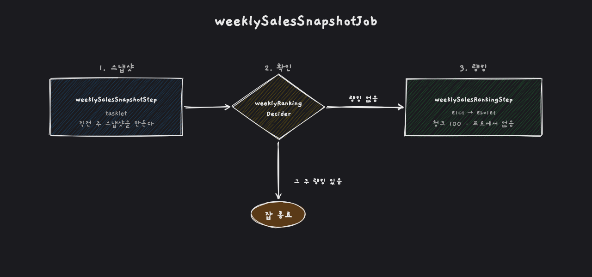
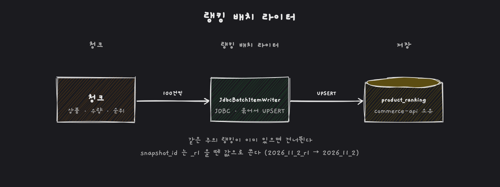

# 랭킹 배치

- 청크 단위로 처리하고, 청크 크기는 100 이다.

## 잡 흐름

```
weeklySalesSnapshotJob
 beforeJob                   포인터를 IN_PROGRESS 로 남긴다 (PUBLISHED 면 그대로)
 1. weeklySalesSnapshotStep  tasklet 으로 직전 주 스냅샷을 만든다
 2. weeklyRankingDecider     그 주 랭킹이 이미 있으면 랭킹 스텝을 건너뛴다
 3. weeklySalesRankingStep   스냅샷을 읽어 랭킹을 쓴다 (리더 → 라이터, 청크 100, 프로세서 없음)
 4. weeklyRankingPublishStep 스냅샷과 랭킹의 상품 수를 비교하고, 같으면 포인터를 PUBLISHED 로 바꾼다
 afterJob                    잡이 COMPLETED 가 아니면 포인터를 FAILED 로 바꾼다 (PUBLISHED 면 그대로)
```

- 랭킹 스텝은 새 잡을 만들지 않고 기존 `weeklySalesSnapshotJob` 의 스냅샷 스텝 뒤에 붙인다.
- 스케줄러가 UTC 월요일 00:00 (KST 월요일 09:00) 마다 잡을 실행한다. 실행 방법은 `weekly-sales-snapshot-run.md` 에 있다.
- 잡 파라미터는 두 개다. `requestDate` 는 스냅샷 스텝이 직전 주를 계산하는 데 쓰고, `snapshotId` 는 리더와 decider 가 그대로 쓴다. 두 값이 같은 주를 가리키는지는 잡이 검사하지 않는다.
- `requestDate` 는 identifying 파라미터가 아니다. 같은 주는 항상 같은 JobInstance 라서, 실패한 주를 다시 실행하면 이어서 하고, 성공한 주를 다시 실행하면 Spring Batch 가 막는다.



그림은 공개 스텝과 포인터 리스너를 넣기 전의 흐름이다.

## 스냅샷

- `weeklySalesSnapshotJob` 의 첫 스텝이 tasklet 으로 스냅샷을 만든다. `requestDate` 직전 주(월~일)에 확정된 구매기록을 상품별로 합쳐 `product_sales_snapshot` 에 넣는다.
- 랭킹 스텝은 그 다음 스텝이고, 리더가 이 스냅샷을 읽는다.
- 테이블 구조는 `product-sales-snapshot-table.md`, 실행 방법은 `weekly-sales-snapshot-run.md` 에 있다.

## 랭킹 테이블

- 테이블 정의는 `product-ranking-table.md` 에 있다.
- 엔티티는 commerce-api 가 가진다.
- 한 주에 팔린 상품을 전부 담는다.
- 한 주 안에서 상품은 겹치지 않는다. 동점이면 같은 순위를 주고, 다음 순위는 건너뛰지 않는다 (1, 2, 2, 3).
- 점수는 판매 수량이다.
- 시작일은 시각 없이 날짜만 둔다.
- `snapshot_id` 는 스냅샷과 같은 `연도_월_주차` 형식이고, 리비전(`_r1`)은 붙이지 않는다 (예 `2026_11_2`). 랭킹에는 리비전이 필요 없다. 늦은 구매는 지금 다루지 않고, 나중에 리비전이 생기면 합쳐서 한 주의 랭킹 하나로 만든다.
- 시작일은 항상 월요일이다.
- 점수는 1 이상이다.
- 랭킹은 1 등부터 시작한다.

## 포인터 테이블

- 테이블 정의는 `product-ranking-pointer-table.md` 에 있다.
- 엔티티는 commerce-api 가 가진다.
- 한 주에 포인터는 하나다. `snapshot_id` 는 랭킹과 같은 형식이고 리비전을 붙이지 않는다.
- 상태는 `IN_PROGRESS`, `FAILED`, `PUBLISHED` 이고, `PUBLISHED` 는 한 번 되면 되돌아가지 않는다.
- `product_count` 는 공개 확인을 통과한 `product_ranking` 행 수다. 실패하면 비워 두고, 구매 0 건인 주는 0 으로 공개한다.
- 상태 전이, 공개 tasklet, API 응답 정책, 예외 경우, 테스트 시나리오는 `ranking-publication-plan.md` 에 있다.

## 리더

- 스냅샷은 JDBC 로 읽는다. 리더는 Spring Batch 의 `JdbcCursorItemReader` 를 쓴다.
- 스냅샷은 구매기록을 주차·상품별로 합쳐 둔 사본이고, 한 번 쓰면 바뀌지 않는다. `ProductSalesSnapshot` 엔티티의 검증은 만들 때 지킬 규칙이라 읽을 때는 필요 없다. 그래서 JPA 를 거칠 이유가 없다.
- 페이징(`JdbcPagingItemReader`)이 아니라 커서로 읽는다. 스냅샷은 주차마다 팔린 상품 수만큼만 행이 생겨서, 구매가 늘어도 읽을 양이 크지 않다. 연결을 오래 잡거나 여러 스레드로 나눠 읽어야 할 만큼 커지면 그때 페이징으로 바꾼다.
- 한 번에 한 주를 읽는다. 읽을 주는 `snapshot_id` 로 고른다.
- 판매 수량이 많은 순으로 읽고, 수량이 같으면 상품 id 가 작은 순으로 읽는다.
- 랭킹에 쓸 `snapshot_id`(리비전을 뗀 값)와 주 시작일(`period_start` 의 날짜)도 리더 쿼리에서 만든다. 그래서 프로세서는 두지 않는다.
- 순위는 리더 쿼리에서 `DENSE_RANK()` 로 함께 정한다. 행마다 순위가 같이 나오므로 청크를 넘어 순위를 기억할 필요가 없고, 재시작해도 같은 순위가 나온다.
- 인덱스는 새로 만들지 않는다. 기존 인덱스 `(snapshot_id, sales_quantity desc, product_id)` 에 조건·읽는 컬럼이 모두 들어 있어서 테이블 본문은 읽지 않는다. `DENSE_RANK()` 때문에 정렬(filesort)은 한 번 더 일어나지만, 한 주에 팔린 상품 수만큼이라 감당할 만하다.


```sql
SELECT SUBSTRING_INDEX(snapshot_id, '_r', 1) AS snapshot_id,
       DATE(period_start) AS period_start,
       product_id,
       sales_quantity,
       DENSE_RANK() OVER (ORDER BY sales_quantity DESC) AS ranking
FROM product_sales_snapshot
WHERE snapshot_id = '2026_11_2_r1'
ORDER BY sales_quantity DESC, product_id;
```

## 라이터

- `JdbcBatchItemWriter` 로 쓴다.
- 쓰는 테이블 `product_ranking` 의 엔티티는 commerce-api 가 가진다. 배치는 엔티티를 거치지 않고 JDBC 로 그 테이블에 쓴다.
- 같은 주의 랭킹이 이미 있으면 건너뛴다. 스냅샷 스텝과 랭킹 스텝 사이의 decider 가 그 주 랭킹이 있는지 보고, 있으면 랭킹 스텝을 실행하지 않고 잡을 끝낸다.
- 랭킹 스텝이 실패한 뒤 재시작할 때는 이미 쓴 청크가 있어도 건너뛰지 않고 이어서 쓴다.
- `snapshot_id` 는 리더가 읽은 스냅샷 식별자에서 리비전(`_r1`)을 뗀 값으로 쓴다 (`2026_11_2_r1` → `2026_11_2`).
- `created_at`, `updated_at` 은 UTC 로 넣는다. 스냅샷과 같은 기준으로 통일한다.



```sql
INSERT INTO product_ranking
    (snapshot_id, period_start, product_id, score, ranking, created_at, updated_at)
VALUES
    ('2026_11_2', '2026-11-09', 20, 9, 1, UTC_TIMESTAMP(6), UTC_TIMESTAMP(6));
```
