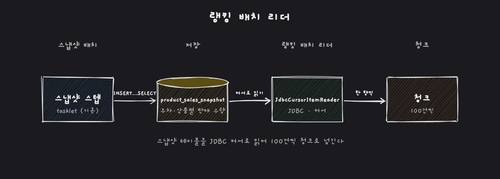

# 랭킹 배치

- 청크 단위로 처리하고, 청크 크기는 100 이다.

## 리더

- 스냅샷은 JDBC 로 읽는다. 리더는 Spring Batch 의 `JdbcCursorItemReader` 를 쓴다.
- 스냅샷은 구매기록을 주차·상품별로 합쳐 둔 사본이고, 한 번 쓰면 바뀌지 않는다. `ProductSalesSnapshot` 엔티티의 검증은 만들 때 지킬 규칙이라 읽을 때는 필요 없다. 그래서 JPA 를 거칠 이유가 없다.
- 페이징(`JdbcPagingItemReader`)이 아니라 커서로 읽는다. 스냅샷은 주차마다 팔린 상품 수만큼만 행이 생겨서, 구매가 늘어도 읽을 양이 크지 않다. 연결을 오래 잡거나 여러 스레드로 나눠 읽어야 할 만큼 커지면 그때 페이징으로 바꾼다.
- 한 번에 한 주를 읽는다. 읽을 주는 `snapshot_id` 로 고른다.
- 판매 수량이 많은 순으로 읽고, 수량이 같으면 상품 id 가 작은 순으로 읽는다.
- 인덱스는 새로 만들지 않는다. 기존 인덱스 `(snapshot_id, sales_quantity desc, product_id)` 에 조건·정렬·읽는 컬럼이 모두 들어 있어서 인덱스만 읽고 끝난다.



```sql
SELECT product_id, sales_quantity
FROM product_sales_snapshot
WHERE snapshot_id = '2026_11_2_r1'
ORDER BY sales_quantity DESC, product_id;
```
